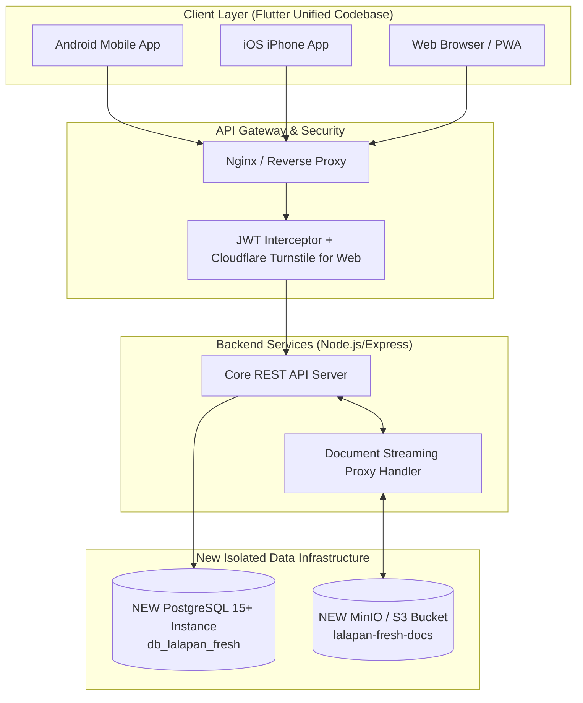
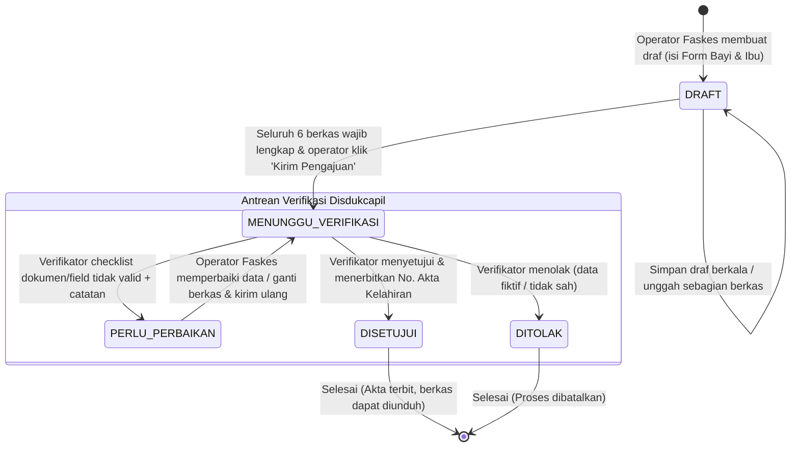

# 📑 Product Requirement Document (PRD)
## Lalapan Cross-Platform (Android, iOS, Web)
### *Sistem Terpadu Pelaporan Kelahiran & Penerbitan Akta Disdukcapil – Faskes*

---

## 1. 🎯 Ringkasan Eksekutif & Tujuan Proyek

### 1.1 Latar Belakang
Sistem **Lalapan** (*Layanan Administrasi Kelahiran Cepat, Akurat, dan Terintegrasi*) adalah platform jembatan digital antara **Fasilitas Kesehatan (Rumah Sakit & Puskesmas)** dengan **Dinas Kependudukan dan Pencatatan Sipil (Disdukcapil)**. Platform ini memfasilitasi pelaporan persalinan baru dari faskes secara *real-time*, validasi berkas medis/kependudukan berjenjang, checklist revisi interaktif, hingga persetujuan dan penerbitan nomor Akta Kelahiran resmi.

### 1.2 Tujuan Inisiatif Baru
1. **Multi-Platform Portability**: Membangun aplikasi lintas platform yang berjalan mulus di **Android**, **iOS (iPhone/iPad)**, dan **Web Browser** menggunakan satu basis kode (*single codebase*).
2. **Total Environment & Data Isolation**: Seluruh arsitektur data (Database PostgreSQL, Object Storage MinIO/S3, Redis/Cache) **100% baru dan terisolasi secara mandiri**, tanpa berbagi kredensial, host, atau bucket dengan proyek eksisting.
3. **Identical Functional Parity**: Seluruh logika bisnis, alur status permohonan, aturan keamanan *multi-tenancy*, peran pengguna (*RBAC*), hingga modul verifikasi checklist dipertahankan persis sama seperti proyek web eksisting.

---

## 2. 📱 Analisis & Panduan Khusus Ekosistem iOS (iPhone)

### 2.1 Apakah Aplikasi Bisa Berjalan di iPhone?
**Ya, 100% bisa.** Dengan menggunakan **Flutter (Dart)**, kode aplikasi yang ditulis dapat dikompilasi langsung menjadi kode mesin *native* iOS (Objective-C/Swift binary) yang berkinerja tinggi (60–120 FPS).

### 2.2 Kebutuhan & Batasan Teknis untuk iPhone (iOS):
Meskipun basis kode Flutter sama, platform iOS memiliki regulasi keamanan dan lingkungan build khusus yang wajib dipenuhi:

| Komponen | Persyaratan Teknis iOS | Catatan Penting |
|---|---|---|
| **Mesin Build** | Memerlukan komputer dengan sistem operasi **macOS** & **Xcode** terbaru | Build IPA untuk iPhone tidak dapat dikompilasi langsung di Windows/Linux tanpa Mac remote, CI/CD (GitHub Actions / Codemagic), atau Mac Mini/Cloud. |
| **Izin Privasi (`Info.plist`)** | Deklarasi wajib string deskripsi izin di file `ios/Runner/Info.plist`: <br>• `NSCameraUsageDescription`: Untuk memotret berkas Surat Kelahiran/KTP.<br>• `NSPhotoLibraryUsageDescription`: Untuk memilih gambar dari galeri.<br>• `NSMicrophoneUsageDescription`: Opsional (jika rekaman video digunakan). | Jika string alasan izin tidak diisi atau terlalu pendek, Apple otomatis menolak aplikasi (*App Store Rejection*). |
| **Penyimpanan Berkas (iOS Sandbox)** | Menggunakan direktori sementara (`getTemporaryDirectory()`) atau dokumen aplikasi (`getApplicationDocumentsDirectory()`) melalui plugin `path_provider`. | iOS melarang akses file sistem terbuka (*sandboxed filesystem*). Unduhan ZIP atau preview file harus disimpan di direktori internal app. |
| **UI Safe Area & Dynamic Island** | Menggunakan widget `SafeArea()` di Flutter untuk menghindari tabrakan dengan *Notch*, *Dynamic Island*, dan *Home Indicator* bawah iPhone. | Desain harus responsif terhadap berbagai ukuran layar iPhone (dari iPhone SE hingga iPhone Pro Max). |
| **Distribusi Aplikasi** | Memerlukan **Apple Developer Account** (biaya tahunan $99) jika ingin didistribusikan via: <br>• **TestFlight** (uji coba privat internal/faskes).<br>• **App Store** (publik).<br>• Atau *Ad-Hoc/Enterprise Certificate* (MDM Pemda). | Untuk tahap lokal testing (development), iPhone fisik bisa dihubungkan langsung ke Mac via kabel dengan akun Apple ID gratis. |

---

## 3. 🛠️ Rekomendasi Arsitektur & Teknologi

### 3.1 Mengapa Flutter (Dart) adalah Pilihan Paling Tepat?
1. **Single Codebase**: Satu basis kode untuk 3 target platform sekaligus:
   - **Android**: APK / AAB.
   - **iOS**: IPA (iPhone & iPad).
   - **Web**: Progressive Web App (PWA) / Single Page Application untuk browser desktop (Chrome, Edge, Safari).
2. **Native Performance**: Flutter mengompilasi kode ke native ARM/x86 binary (bukan webview wrapper seperti Cordova/Ionic), sehingga transisi dan *gestures* (zoom, pan, rotate dokumen persalinan) sangat responsif.
3. **Adaptive UI**: Flutter menyediakan widget *Cupertino* (gaya iOS) dan *Material 3* (gaya Android) yang dapat disesuaikan otomatis mengikuti platform.

### 3.2 Tumpukan Teknologi Terisolasi (Target Arsitektur Baru)



#### Spesifikasi Komponen Baru:
- **Frontend / Client**: Flutter 3.24+ (Dart 3.5+).
  - State Management: **Riverpod 2.x** atau **BLoC**.
  - Networking: **Dio** (dengan interceptor JWT, auto refresh token, dan error logger).
  - Navigation / Routing: **GoRouter** (deep linking untuk pelacakan publik).
  - Document Viewer: **photo_view** (pinch-to-zoom, pan, rotate) & **flutter_pdfview** (preview PDF).
  - Storage Lokal: **flutter_secure_storage** (menyimpan JWT aman di Keychain iOS & Keystore Android).
- **Backend**: Node.js & Express.js (atau Go / Dart-Frog) terpisah.
- **Database Baru**: PostgreSQL 15/16 terpisah (nama database: `lalapan_mobile_db`, port terisolasi).
- **Object Storage Baru**: Instance MinIO baru atau Bucket independen baru (`lalapan-mobile-documents`) dengan *Access Key* dan *Secret Key* khusus.

---

## 4. 👥 Aktor, Peran, & Hak Akses (RBAC)

Sistem memiliki 4 kategori aktor:

| Peran (Role) | Kode Sistem | Ruang Lingkup & Hak Akses |
|---|---|---|
| **Operator Faskes** (Bidan / Petugas RS / PKM) | `OPERATOR_RS` | • Mengisi data kelahiran (Bayi & Ibu).<br>• Mengambil foto / unggah 6 dokumen persyaratan.<br>• Melihat dan memperbaiki draft pengajuan miliknya.<br>• **Aturan Multi-Tenancy**: Hanya dapat melihat data faskes tempat ia bertugas (`institution_id`). |
| **Operator Dukcapil** (Verifikator Disdukcapil) | `OPERATOR_DUKCAPIL` | • Mengakses seluruh antrean permohonan masuk lintas 29 faskes.<br>• Memeriksa kelengkapan data & pratinjau dokumen.<br>• Memberi tanda revisi per-field & per-dokumen (*Checklist Revisi*).<br>• Menyetujui pengajuan & menginputkan nomor registrasi Akta Kelahiran.<br>• Menolak pengajuan permanen. |
| **Administrator** (Super Admin) | `ADMIN` | • Mengelola akun pengguna (tambah, edit, reset password, aktif/nonaktifkan).<br>• Mengelola master data instansi faskes.<br>• Melihat riwayat audit lengkap (*activity logs*).<br>• Akses penuh ke seluruh fitur operator & verifikator. |
| **Masyarakat Umum** (Publik) | *Tanpa Login* | • Mengakses modul lacak pengajuan publik via Nomor Registrasi (`PGJ-YYYYMM-XXX`) atau nama bayi + nama ibu.<br>• Melihat linimasa status tanpa login. |

---

## 5. 🔄 Siklus Hidup Permohonan & State Machine



### 5.1 Matriks Status Permohonan:
1. **`DRAFT`**: Formulir tersimpan di lokal faskes. Belum terlihat di antrean Disdukcapil.
2. **`MENUNGGU_VERIFIKASI`**: Berkas telah dikirim faskes dan masuk antrean kerja verifikator Dukcapil.
3. **`PERLU_PERBAIKAN`**: Berkas dikembalikan ke faskes pengaju dengan detail checklist item yang salah.
4. **`DISETUJUI`**: Diverifikasi sah. Nomor Akta Kelahiran diterbitkan.
5. **`DITOLAK`**: Ditolak secara definitif dengan alasan resmi yang tercatat di audit log.

---

## 6. 📋 Spesifikasi Kebutuhan Fungsional (Feature Specifications)

### Modul 1: Autentikasi & Manajemen Sesi
- **ID Fitur**: `FEAT-AUTH-01`
- **Fungsi**:
  - Login menggunakan `username` dan `password`.
  - Dukungan captcha anti-bot (Cloudflare Turnstile pada platform Web; opsional biometric Fingerprint/FaceID pada Android & iOS).
  - Token JWT berbasis waktu (Access Token 24 jam) disimpan di `flutter_secure_storage`.
  - Auto-logout jika token kadaluarsa atau akun dinonaktifkan oleh Admin.
  - Perubahan sandi mandiri (*Change Password*) pada profil pengguna.

### Modul 2: Pelacakan Publik (Public Tracking Portal)
- **ID Fitur**: `FEAT-TRACK-01`
- **Fungsi**:
  - Halaman awal publik tanpa memerlukan autentikasi login.
  - Pencarian permohonan instan berdasarkan:
    1. Nomor Registrasi resmi (contoh: `PGJ-202610-001`).
    2. Nama Bayi atau Nama Ibu Kandung.
  - Menampilkan linimasa visual interaktif (*Step Progress Bar*): `Pengajuan Dibuat` ➔ `Verifikasi Berkas` ➔ `Penerbitan Akta` ➔ `Selesai`.
  - Jika status `PERLU_PERBAIKAN`, menampilkan instruksi untuk menghubungi faskes terkait tanpa membocorkan data medis sensitif ke publik.

### Modul 3: Formulir Pengajuan Kelahiran (Faskes Operator)
- **ID Fitur**: `FEAT-APP-01`
- **Alur Wizard 3 Langkah (Multi-Step Form)**:
  - **Langkah 1: Data Bayi & Data Ibu**:
    - Data Bayi: Nama lengkap, jenis kelamin (`LAKI_LAKI` / `PEREMPUAN`), tanggal lahir, jam lahir, tempat lahir, anak ke- (urutan kelahiran), berat lahir (gram), panjang lahir (cm), kondisi lahir (`SEHAT`, `KOMPLIKASI`, `MENINGGAL`), nomor rekam medis RS.
    - Data Ibu: Nama lengkap ibu kandung.
    - Tombol *Simpan Draf* dapat ditekan kapan saja tanpa harus mengisi seluruh dokumen.
  - **Langkah 2: Unggah 6 Berkas Dokumen Persyaratan**:
    - Kamera langsung (Native Camera) atau Galeri / File Picker (PDF/JPG/PNG).
    - Daftar Dokumen Wajib:
      1. `KTP_IBU` (KTP Elektronik Ibu Kandung).
      2. `KTP_AYAH` (KTP Elektronik Ayah Kandung).
      3. `KARTU_KELUARGA` (Kartu Keluarga Terdaftar).
      4. `SURAT_KETERANGAN_LAHIR_RS` (Surat Kelahiran Resmi RS/Puskesmas).
      5. `BUKU_NIKAH` (Buku Nikah / Akta Perkawinan Orang Tua).
      6. `REKAM_MEDIS_IA_DAN_BAYI` (Resume Rekam Medis Persalinan).
  - **Langkah 3: Review & Submit**:
    - Pratinjau ringkasan data sebelum dikirim.
    - Validasi kelengkapan otomatis: Tombol "Kirim Pengajuan" dinonaktifkan jika ada 1 dari 6 dokumen wajib yang belum diunggah.
    - Konfirmasi modal sebelum data dikirim ke antrean Disdukcapil.

### Modul 4: Pratinjau Dokumen Interaktif (Interactive Document Viewer)
- **ID Fitur**: `FEAT-DOC-01`
- **Fungsi**:
  - Pratinjau langsung file gambar (JPG/PNG/WEBP) dan dokumen PDF tanpa perlu keluar dari aplikasi.
  - Fitur gestur interaktif:
    - *Pinch-to-zoom* (perbesar hingga 4x untuk membaca teks kecil di KTP/Surat Lahir).
    - *Pan / Drag* untuk menggeser dokumen saat zoom aktif.
    - *Rotate 90°* (putar kanan/kiri untuk berkas hasil scan miring).
    - *Switch next/previous doc* langsung dari layar viewer.
  - Tombol unduh individual dan unduh paket arsip `.zip` berisi seluruh berkas pengajuan.

### Modul 5: Modul Verifikasi Disdukcapil (Dukcapil Queue & Decision)
- **ID Fitur**: `FEAT-VERIF-01`
- **Fungsi**:
  - Daftar antrean permohonan berstatus `MENUNGGU_VERIFIKASI` (dapat difilter per faskes, rentang tanggal, atau nama).
  - Tampilan split / tab detail antara data teks dan berkas lampiran.
  - **Sistem Checklist Revisi Interaktif**:
    - Verifikator dapat menandai item teks tertentu yang salah (misal: Tanggal lahir salah, No RM kurang).
    - Verifikator dapat mencentang berkas dokumen yang buram / salah upload.
    - Verifikator wajib memasukkan catatan deskripsi perbaikan.
    - Saat submit revisi, status permohonan beralih ke `PERLU_PERBAIKAN` dan riwayat tercatat di `activity_logs`.
  - **Persetujuan (Approve)**:
    - Input nomor resmi Akta Kelahiran (contoh: `3519-LT-19102026-0001`).
    - Input catatan opsional.
    - Status beralih ke `DISETUJUI`.
  - **Penolakan (Reject)**:
    - Input alasan penolakan definitif. Status beralih ke `DITOLAK`.

### Modul 6: Penanganan Status Perbaikan di Sisi Faskes
- **ID Fitur**: `FEAT-REV-01`
- **Fungsi**:
  - Pengajuan berstatus `PERLU_PERBAIKAN` menampilkan kotak peringatan (*alert banner*) berwarna kuning cerah berisi catatan verifikator.
  - Bidang isian (*input fields*) yang ditandai salah otomatis disorot warna merah dengan ikon peringatan.
  - Dokumen yang ditandai salah memiliki tombol khusus "Ganti Berkas / Upload Ulang".
  - Tombol "Kirim Ulang Hasil Perbaikan" yang akan mengembalikan status ke `MENUNGGU_VERIFIKASI`.

### Modul 7: Dashboard Statistik & Ekspor Laporan
- **ID Fitur**: `FEAT-DASH-01`
- **Fungsi**:
  - Kartu ringkasan metrik: Total Pengajuan, Menunggu Verifikasi, Perlu Perbaikan, Disetujui, Ditolak.
  - Filter rentang tanggal pengajuan.
  - Ekspor data tabular ke file Excel (`.xlsx`) langsung di perangkat (Web & Mobile).

### Modul 8: Manajemen Pengguna & Master Instansi (Admin Khusus)
- **ID Fitur**: `FEAT-ADM-01`
- **Fungsi**:
  - Manajemen akun: Pembuatan akun operator faskes dengan binding ke instansi resmi.
  - Reset kata sandi pengguna secara instan.
  - Sakelar aktif/nonaktif akun (status suspensi).
  - Master data 29 Faskes Kabupaten Madiun (3 RSUD + 26 Puskesmas) dengan kemampuan penambahan instansi baru.

---

## 7. 🗄️ Desain Basis Data Terisolasi (PostgreSQL DDL)

> [!IMPORTANT]
> Skema ini dijalankan pada database baru (misal: `pengajuan_mobile_db`) yang terpisah secara fisik/konfigurasi dari database sistem sebelumnya.

```sql
-- Extension UUID & Kriptografi
CREATE EXTENSION IF NOT EXISTS "uuid-ossp";
CREATE EXTENSION IF NOT EXISTS "pgcrypto";

-- 1. INSTITUTIONS
CREATE TABLE institutions (
  id VARCHAR(64) PRIMARY KEY,
  type VARCHAR(30) NOT NULL DEFAULT 'RS',
  name VARCHAR(200) NOT NULL,
  code VARCHAR(50) NOT NULL UNIQUE,
  address TEXT NOT NULL,
  head_of_service VARCHAR(150),
  phone VARCHAR(50),
  email VARCHAR(100),
  is_active BOOLEAN NOT NULL DEFAULT TRUE,
  created_at TIMESTAMPTZ NOT NULL DEFAULT NOW(),
  updated_at TIMESTAMPTZ NOT NULL DEFAULT NOW()
);

-- 2. USERS
CREATE TABLE users (
  id VARCHAR(64) PRIMARY KEY,
  username VARCHAR(50) NOT NULL UNIQUE,
  password VARCHAR(255) NOT NULL,
  plain_password VARCHAR(255),
  full_name VARCHAR(150) NOT NULL,
  role VARCHAR(50) NOT NULL, -- 'OPERATOR_RS', 'OPERATOR_DUKCAPIL', 'ADMIN'
  institution_id VARCHAR(64) REFERENCES institutions(id) ON DELETE SET NULL,
  institution_name VARCHAR(200),
  nip VARCHAR(50),
  email VARCHAR(100),
  phone VARCHAR(50),
  is_active BOOLEAN NOT NULL DEFAULT TRUE,
  created_at TIMESTAMPTZ NOT NULL DEFAULT NOW(),
  updated_at TIMESTAMPTZ NOT NULL DEFAULT NOW()
);

-- 3. APPLICATIONS
CREATE TABLE applications (
  id VARCHAR(64) PRIMARY KEY,
  pgj_number VARCHAR(64) UNIQUE,
  registration_number VARCHAR(64),
  status VARCHAR(50) NOT NULL DEFAULT 'DRAFT', -- DRAFT, MENUNGGU_VERIFIKASI, PERLU_PERBAIKAN, DISETUJUI, DITOLAK
  operator_id VARCHAR(64) NOT NULL REFERENCES users(id) ON DELETE CASCADE,
  verifikator_id VARCHAR(64) REFERENCES users(id) ON DELETE SET NULL,
  institution_id VARCHAR(64) REFERENCES institutions(id) ON DELETE SET NULL,
  institution_name VARCHAR(200),
  submitted_at TIMESTAMPTZ,
  verified_at TIMESTAMPTZ,
  last_revision_note TEXT,
  last_reject_note TEXT,
  revision_count INTEGER NOT NULL DEFAULT 0,
  akta_kelahiran_number VARCHAR(100),
  notes JSONB,
  created_at TIMESTAMPTZ NOT NULL DEFAULT NOW(),
  updated_at TIMESTAMPTZ NOT NULL DEFAULT NOW()
);

-- 4. BABY
CREATE TABLE baby (
  id VARCHAR(64) PRIMARY KEY,
  application_id VARCHAR(64) NOT NULL UNIQUE REFERENCES applications(id) ON DELETE CASCADE,
  full_name VARCHAR(150) NOT NULL,
  gender VARCHAR(20) NOT NULL, -- 'LAKI_LAKI', 'PEREMPUAN'
  birth_order INTEGER NOT NULL DEFAULT 1,
  birth_weight_gram INTEGER,
  birth_length_cm DECIMAL(5,1),
  birth_place VARCHAR(200) NOT NULL,
  birth_date DATE NOT NULL,
  birth_time VARCHAR(20) NOT NULL,
  condition VARCHAR(50) NOT NULL DEFAULT 'SEHAT',
  medical_record_no VARCHAR(100),
  created_at TIMESTAMPTZ NOT NULL DEFAULT NOW(),
  updated_at TIMESTAMPTZ NOT NULL DEFAULT NOW()
);

-- 5. MOTHER
CREATE TABLE mother (
  id VARCHAR(64) PRIMARY KEY,
  application_id VARCHAR(64) NOT NULL UNIQUE REFERENCES applications(id) ON DELETE CASCADE,
  full_name VARCHAR(150) NOT NULL,
  created_at TIMESTAMPTZ NOT NULL DEFAULT NOW(),
  updated_at TIMESTAMPTZ NOT NULL DEFAULT NOW()
);

-- 6. APPLICATION_DOCUMENTS
CREATE TABLE application_documents (
  id VARCHAR(64) PRIMARY KEY,
  application_id VARCHAR(64) NOT NULL REFERENCES applications(id) ON DELETE CASCADE,
  document_type VARCHAR(50) NOT NULL, -- KTP_IBU, KTP_AYAH, KARTU_KELUARGA, SURAT_KETERANGAN_LAHIR_RS, BUKU_NIKAH, REKAM_MEDIS_IA_DAN_BAYI
  file_name VARCHAR(255) NOT NULL,
  original_file_name VARCHAR(255),
  file_url TEXT,
  storage_key VARCHAR(255),
  file_size BIGINT,
  mime_type VARCHAR(100),
  uploader_id VARCHAR(64) REFERENCES users(id) ON DELETE SET NULL,
  uploaded_at TIMESTAMPTZ NOT NULL DEFAULT NOW(),
  created_at TIMESTAMPTZ NOT NULL DEFAULT NOW(),
  updated_at TIMESTAMPTZ NOT NULL DEFAULT NOW(),
  UNIQUE(application_id, document_type)
);

-- 7. ACTIVITY_LOGS (Audit Trail)
CREATE TABLE activity_logs (
  id VARCHAR(64) PRIMARY KEY,
  application_id VARCHAR(64) REFERENCES applications(id) ON DELETE CASCADE,
  user_id VARCHAR(64) REFERENCES users(id) ON DELETE SET NULL,
  user_role VARCHAR(50),
  user_full_name VARCHAR(150),
  event_type VARCHAR(50) NOT NULL,
  action VARCHAR(50),
  old_status VARCHAR(50),
  new_status VARCHAR(50),
  summary TEXT,
  notes TEXT,
  metadata_json JSONB,
  ip_address VARCHAR(50),
  user_agent TEXT,
  timestamp TIMESTAMPTZ NOT NULL DEFAULT NOW()
);

-- INDEXES
CREATE INDEX idx_users_username ON users(username);
CREATE INDEX idx_users_institution_id ON users(institution_id);
CREATE INDEX idx_applications_operator_id ON applications(operator_id);
CREATE INDEX idx_applications_status ON applications(status);
CREATE INDEX idx_applications_pgj_number ON applications(pgj_number);
CREATE INDEX idx_documents_app_id ON application_documents(application_id);
CREATE INDEX idx_activity_logs_app_id ON activity_logs(application_id);
```

---

## 8. ☁️ Kebijakan Isolasi Object Storage (MinIO / S3)

Untuk memastikan berkas tidak bercampur atau menimpa berkas proyek lama:
1. **Bucket Baru**: Menggunakan nama bucket khusus, misalnya `lalapan-mobile-documents`.
2. **Kredensial Terpisah**: Menggunakan `ACCESS_KEY` dan `SECRET_KEY` terpisah pada MinIO baru.
3. **Pola Penamaan Object Key**:
   ```text
   {registration_number}/{document_type}_{timestamp}.{ext}
   Contoh:
   PGJ-202610-001/SURAT_KETERANGAN_LAHIR_RS_1729501234567.jpg
   PGJ-202610-001/KARTU_KELUARGA_1729501244512.pdf
   ```
4. **Streaming Proxy**: Client (Flutter di Android/iOS/Web) tidak memanggil IP MinIO langsung, melainkan melalui endpoint backend streaming `/api/documents/view/:id` demi keamanan jaringan internal faskes.

---

## 9. 🌐 Spesifikasi Kontrak REST API

Basis URL API: `https://api-lalapan-mobile.domain.com/api` (atau `http://localhost:5001/api` pada lokal dev).

### Format Standar Respons JSON
```json
{
  "success": true,
  "data": { ... },
  "message": "Pesan deskriptif"
}
```

### Ringkasan Endpoint Utama
| Kategori | Method | Endpoint | Deskripsi | Akses |
|---|---|---|---|---|
| **Auth** | `POST` | `/api/auth/login` | Login user & dapatkan token JWT | Publik |
| | `GET` | `/api/auth/me` | Ambil identitas user yang sedang login | Bearer Token |
| | `POST` | `/api/auth/change-password` | Ubah password sendiri | Bearer Token |
| **Tracking**| `GET` | `/api/applications/public/track?q=...` | Lacak status permohonan publik | Tanpa Login |
| **Pengajuan** | `GET` | `/api/applications` | Daftar pengajuan (terfilter instansi jika `OPERATOR_RS`) | Bearer Token |
| | `GET` | `/api/applications/:id` | Detail pengajuan, data bayi, ibu, & riwayat | Bearer Token |
| | `POST` | `/api/applications` | Buat draft pengajuan baru | Operator & Admin |
| | `PUT` | `/api/applications/:id` | Simpan perubahan data draf | Operator & Admin |
| | `POST` | `/api/applications/:id/submit` | Kirim permohonan ke verifikasi Dukcapil | Operator & Admin |
| | `DELETE`| `/api/applications/:id` | Hapus draft pengajuan | Operator & Admin |
| **Dokumen** | `POST` | `/api/documents/upload` | Unggah 1 berkas fisik (multipart/form-data) | Bearer Token |
| | `GET` | `/api/documents/view/:id` | Stream pratinjau berkas (inline browser/app) | Publik / Token |
| | `GET` | `/api/documents/:applicationId/download-zip` | Unduh arsip zip semua berkas | Bearer Token |
| | `DELETE`| `/api/documents/:id` | Hapus 1 berkas lampiran | Operator & Admin |
| **Verifikasi**| `GET` | `/api/verification/queue` | Ambil antrean menunggu verifikasi | Dukcapil & Admin |
| | `POST` | `/api/verification/:id/approve` | Setujui & terbitkan Nomor Akta Kelahiran | Dukcapil & Admin |
| | `POST` | `/api/verification/:id/request-revision`| Minta perbaikan berkas & checklist field | Dukcapil & Admin |
| | `POST` | `/api/verification/:id/reject` | Tolak permohonan permanen | Dukcapil & Admin |
| **Master** | `GET` | `/api/institutions` | Ambil daftar 29 Faskes resmi | Bearer Token |
| | `POST` | `/api/institutions` | Tambah faskes baru | Admin Only |
| **User** | `GET` | `/api/users` | List akun pengguna sistem | Admin Only |
| | `POST` | `/api/users` | Buat akun operator/dukcapil baru | Admin Only |
| | `POST` | `/api/users/:id/reset-password` | Reset password akun | Admin Only |
| | `PATCH`| `/api/users/:id/toggle-active` | Aktifkan/nonaktifkan akun | Admin Only |

---

## 10. 📐 Desain Arsitektur Folder Flutter (Client Baru)

```text
lalapan_mobile/
├── android/                   # Konfigurasi native Android (Gradle, Manifest)
├── ios/                       # Konfigurasi native iOS (Xcode, Info.plist, Pods)
├── web/                       # Konfigurasi Web (index.html, manifest.json)
├── lib/
│   ├── main.dart              # Entrypoint aplikasi Flutter
│   ├── core/
│   │   ├── config/            # Base URL, tema warna, environment (.env)
│   │   ├── network/           # Dio client, API interceptors, error handler
│   │   ├── constants/         # Enum role, status pengajuan, tipe dokumen
│   │   ├── utils/             # Format tanggal Indonesia, currency, byte format
│   │   └── widgets/           # Komponen modular (CustomButton, StatusBadge, dll)
│   ├── features/
│   │   ├── auth/              # Halaman Login, Riverpod auth_controller
│   │   ├── public_tracking/   # Halaman Pelacakan Publik & Timeline status
│   │   ├── dashboard/         # Dashboard ringkasan angka & navigasi modul
│   │   ├── application/       # Formulir 3 langkah, Form Bayi & Ibu, list draft
│   │   ├── document_viewer/   # Modal viewer zoom/pan/rotate & PDF reader
│   │   ├── verification/      # Modul antrean verifikator Dukcapil & checklist
│   │   └── admin/             # Manajemen akun pengguna & master instansi
│   └── routes/
│       └── app_router.dart    # GoRouter konfigurasi navigasi & AuthGuard
└── pubspec.yaml               # Dependensi paket Flutter
```

---

## 11. 🚀 Roadmap Implementasi & Tahapan Kerja (Action Plan)

1. **Fase 1: Setup Workspace & Infrastruktur Terisolasi**
   - Buat workspace baru di Antigravity.
   - Setup container/layanan baru: Database PostgreSQL baru (`pengajuan_mobile_db`) dan MinIO bucket baru (`lalapan-mobile-documents`).
   - Eksekusi skema migrasi tabel & seed 29 Faskes Kabupaten Madiun.
2. **Fase 2: Backend API & Document Proxy**
   - Deploy backend REST API dengan endpoint yang identik.
   - Uji coba isolasi upload dokumen dan streaming proxy.
3. **Fase 3: Inisialisasi Proyek Flutter Multi-Platform**
   - Inisialisasi proyek Flutter (`flutter create lalapan_mobile`).
   - Konfigurasi izin Android (`AndroidManifest.xml`) & iOS (`Info.plist`).
   - Implementasi Dio, interceptor token JWT, dan Riverpod state management.
4. **Fase 4: Pembangunan Fitur Inti (Fitur Faskes & Publik)**
   - Halaman Lacak Publik.
   - Halaman Login & Dashboard.
   - Form Pengajuan Kelahiran (3 Langkah: Form Bayi/Ibu, Upload Dokumen Kamera/Galeri, Review & Submit).
   - Document Viewer Interaktif (Pinch-to-zoom, Pan, Rotate).
5. **Fase 5: Pembangunan Fitur Dukcapil & Admin**
   - Antrean Verifikasi Disdukcapil.
   - Modal Checklist Revisi Dokumen & Field.
   - Persetujuan (Penerbitan No. Akta) & Penolakan.
   - Manajemen User & Master Instansi untuk Admin.
6. **Fase 6: Pengujian Lintas Platform (Android, iOS, Web)**
   - Verifikasi performa di browser desktop (Chrome/Edge).
   - Pengujian di perangkat Android (APK).
   - Verifikasi build di simulator/perangkat iPhone (iOS).
